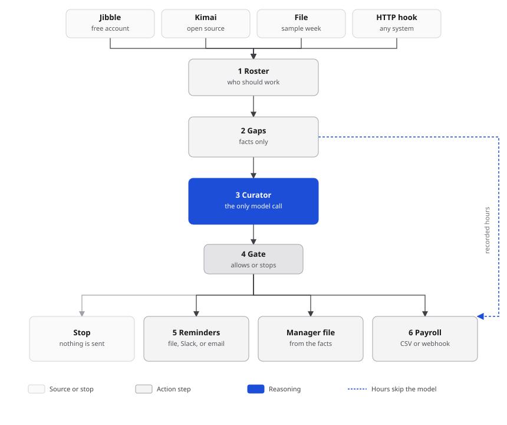

# Timecard Curator

Once a week, someone has to notice who forgot to clock out, ask them to fix it, and send the rest of the hours to payroll. This does that job. It reads time from a tracker, flags the real problems, and writes two things a person can use: a short reminder, and a payroll file.

A dry run is the default. Nothing is emailed until you pass `--send`.



## The week, in order

1. **Roster.** Load the people who were supposed to work, and their punches, for one Monday–Friday. The sample week is 2–6 Mar 2026.
2. **Gaps.** Compare punches to the schedule. This step only reports facts.
   - No time on a work day → missing day. Held out of payroll.
   - Clock-in with no clock-out → open punch. Held out.
   - Under 75% of the expected day → short day. Paid what was recorded. Listed for the manager.
   - More than 60 minutes over the expected day → overtime. Paid, and listed for the manager.
   - A PTO day is not a missing day. Recorded time is paid; the rest of that day is PTO.
   - Overlapping punches are merged, so the same hour is not paid twice.
3. **Curator.** One reasoning call sees the gap list and returns a decision: who to remind, who to hold, and whether payroll may go out. It does not see email addresses.
4. **Gate.** The decision is checked before anything is written. If it breaks a rule, the run stops. No reminder, no payroll file.
5. **Reminders.** One note per person with a blocking gap. A second run of the same week does not send it again.
6. **Payroll.** Hours are added up from the punches. The curator cannot change a number. People with a blocking gap are listed in `payroll_exceptions.csv` instead of `payroll.csv`.

With the default policy, one missing card does not hold the whole company. Set `partial_payroll` to false in `config/policy.json` if you would rather hold everyone.

## What the model is allowed to do

`CLAUDE_KEY` is a Claude Code login, not an Anthropic API key. The curator runs:

```bash
CLAUDE_CODE_OAUTH_TOKEN="$CLAUDE_KEY" claude -p "<case>" --output-format json --max-turns 1
```

`--reasoner local` applies the written policy and does not call Claude. That is what the checks use, so they stay repeatable. `--reasoner auto` calls Claude when `CLAUDE_KEY` is set and the `claude` command is on the path.

The model may word the reminder, and it may hold the whole payroll (that is the safe direction). It may not remind someone with a clean card, pay someone with a missing day or an open punch, invent an employee, or edit hours. If its wording names another employee or scolds the reader, the standard wording is used instead.

## What to connect

You do not need a paid account to run this.

| Job | Use this | Cost |
| --- | --- | --- |
| Time tracking | [Jibble](https://www.jibble.io/) free plan. The org owner creates a key under Organization settings → API credentials. | Free |
| Time tracking, self-hosted | [Kimai](https://github.com/kimai/kimai). Create an API token on the user profile. The token must be allowed to see the team's timesheets. | Open source |
| Reminders | The JSONL outbox in the run folder, or a Slack incoming webhook on a free Slack workspace. | Free |
| Payroll | `payroll.csv`. A clerk imports it, or point `--payroll webhook` at any HTTPS system that accepts a POST. | No account |

If your Jibble plan does not show API credentials, use Kimai or the HTTP hook. The rest of the week does not change.

`python src/main.py hooks` prints the fields each hook expects.

## How a check is scored

`python src/main.py eval` runs the sample week twice and a set of bad decisions. It does not use the network. These are the gates:

| Check | Pass |
| --- | --- |
| Gap recall and precision | 1.00 — the four planted problems, and no extras |
| Severity | 1.00 — hold vs review |
| Payroll | Exact hours, and Ben and Chi stay out of the file |
| Reminders | Only Ben and Chi, and a note never names a colleague |
| Second run | 0 duplicate sends |
| Guardrails | All four unsafe decisions are refused, and a valid one is allowed |
| Manager file | Every flag is listed by name |

The report is `out/eval/eval_report.json`. The command exits non-zero if a gate fails.

## Safety

Secrets stay in the environment. They are not flags, and they are not written to the audit log. Remote URLs have to be HTTPS. `http://127.0.0.1` is allowed so you can try a hook on your own machine. A Jibble client secret is sent in the token POST body, not in the URL. If a request fails, the error text is scrubbed before it is shown.

## Run and deploy

From this folder: `python src/main.py run --reasoner local --out out/demo`

On a server, a Monday morning cron is enough. Docker works for the same offline run (`docker build -t timecard .`). Install the `claude` command on that machine only if you want the live reasoning step. Details and the cron line are in `src/README.md`.
